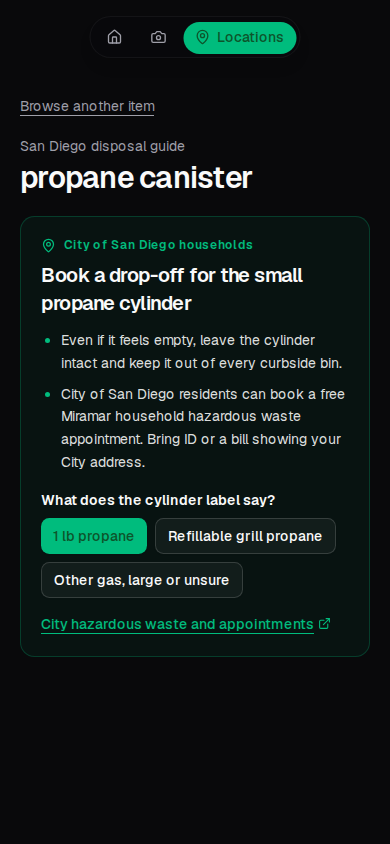
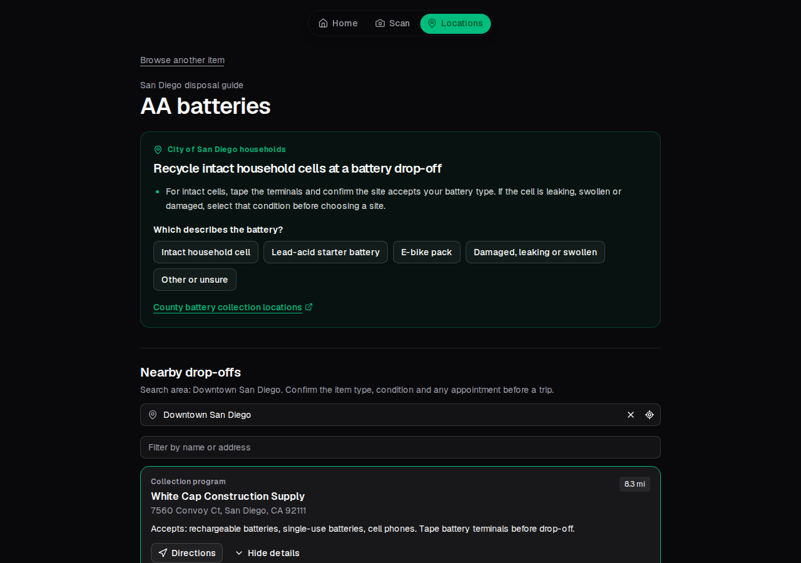

# A San Diego household disposal walkthrough

Scrapp now takes a resident from “what am I holding?” to “what should I do with it here?” A scan can identify several items. Each has its own local instructions, condition answer and destination. The original description and model observations stay available when the resident opens **View disposal options** or returns to the scanner.

## Try it without using a model call

With the frontend running, open the [local household guide](http://localhost:3000/locations). These examples work without camera access, a backend or Google keys.

| Try this | What to look for |
| --- | --- |
| Open **Clothing & fabric**. Select **Clean and usable**, then **Dry but torn or worn**. | The first answer suggests a donation recipient. The second suggests repair, reuse or a recycler that confirms it accepts damaged textiles. Selecting **Paint, oil or chemicals** switches to City handling instructions and removes the site list. [County textile guide](https://www.sandiegocounty.gov/content/sdc/dpw/recycling/Textiles.html) |
| Open **Propane cylinders** and select **1 lb propane**. | The guide gives the Miramar appointment requirement and proof of City residency. **Refillable grill propane** offers a supplier exchange inquiry. **Other gas, large or unsure** asks the resident to confirm the cylinder before transporting it. [City household hazardous waste program](https://www.sandiego.gov/environmental-services/ep/hazardous) |
| Open **Batteries** and select **Intact household cell**. Then select **Damaged, leaking or swollen**. | The first answer offers collection-program cards with addresses, contact details and directions. The second removes those sites and gives handling instructions. An e-bike pack and a lead-acid starter battery each have their own route. [County battery program](https://www.sandiegocounty.gov/content/sdc/dpw/recycling/hhw/uwaste.html) |
| Enter **banana peel**, then try **wine glass** and **glass bottle**. | The guide puts scraps in the green bin, distinguishes unusable dishware from recyclable container glass, and gives the preparation step without asking for the resident’s location. [City bin guide](https://www.sandiego.gov/sites/default/files/what_goes_where_guide_english.pdf) |

Selecting the cylinder size brings the appointment instructions into view on mobile.

## Try the scanner

1. Start the frontend and Flask backend on the matching `feature/san-diego-disposal-guide` branches. Use the frontend and backend README setup steps. For this checkout, the two ignored environment files already contain a matching service credential. The Adaption key belongs only on the Flask side.
2. Open the [local scanner](http://localhost:3000/cam). Upload the [sample AA battery image](./aa-battery.png), leave the description blank and select **Analyze item**. This sends one live provider request. The included image is a synthetic drawing with a legible battery label.
3. Expand **Scan details** to see what the model reported. Choose a battery condition and select **View disposal options**. Use **Original scan details** on the destination page, refresh, then select **Back to scan**. The same item and answer remain selected.
4. For a no-cost variation, type **torn shirt** in the scanner and select **Use local guide**. This creates a local history entry without contacting an inference provider.

In a multi-item result, select the second item on the scan ticket or use **Item from this scan** on the disposal page. Each item remembers its own answer. A shared disposal link carries the item name and chosen condition. The note, confidence and whole-scan summary are read from the originating browser’s history. History stores up to 20 text records. A newly captured photo is available for preview during that scan.

The desktop battery listing uses program records even when Google map tiles and live Places results are unavailable.

## What was verified

| Check | Observed result |
| --- | --- |
| Live Adaption photo-only request | Flask returned HTTP 200. With no note, filename hint or detector output, `gemma-4-26b-a4b-it` identified the sample as **AA alkaline battery** and returned **Special Drop-off**. The response identified its basis as `image` and reported `fallback_used: false`. This was the only paid provider call used for verification. |
| Mobile and desktop handoff | Chromium at 390 × 844 and 1280 × 900 ran the production frontend against real Flask request parsing and authentication with a fixed two-item provider response. The second item, condition, note, observations and summary survived the trip to locations. Refresh, return navigation, independent answers per item and switching items on the destination page all worked. A fresh browser opened the shared condition without access to the original note or summary. |
| Unavailable services | A simulated provider timeout left the description in the form. A local textile lookup still worked. With both Google keys absent, program cards opened their details and supplied directions links. The City appointment and curbside guidance remained accessible. Live Google responses and physical facility acceptance were outside this check. |
| Regression checks | 43 backend tests, 13 frontend tests and the Next.js production build passed. The build emitted lint warnings. Run `python -m pytest -q` in the backend and `npm test` followed by `npm run build` in the frontend. |

The model identifies the object and supplies observations. The local guide uses the identified material and the resident’s answer to choose the City or program instructions. Live Maps listings are places to contact. Each participating program decides what it will accept on the day of a visit.
